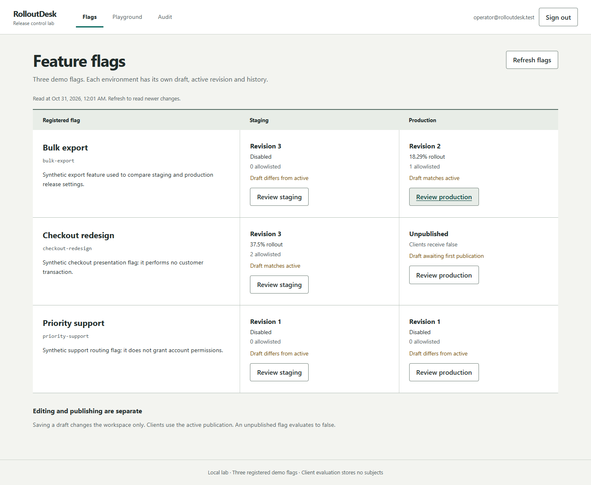
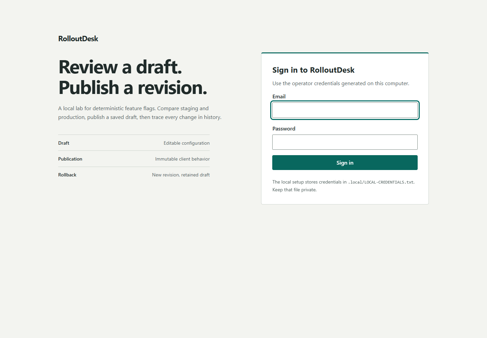
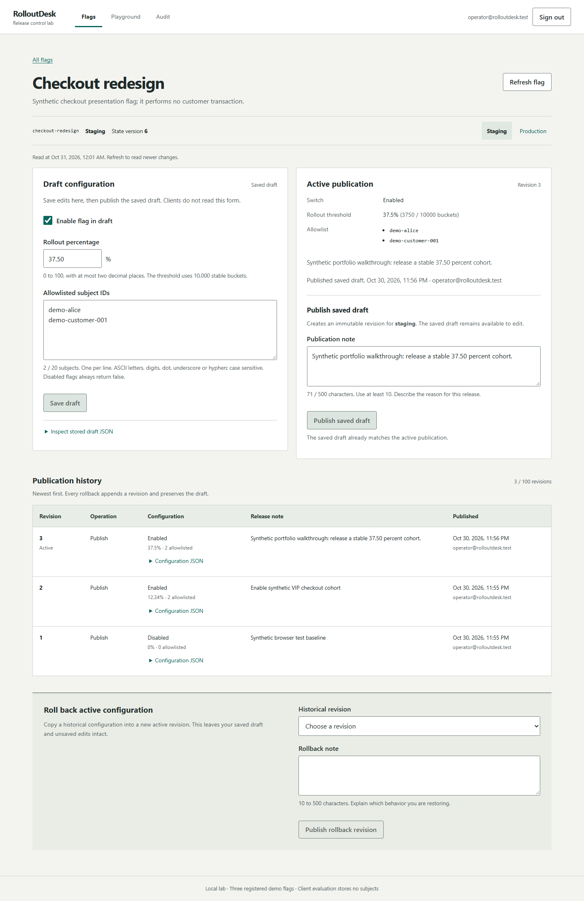
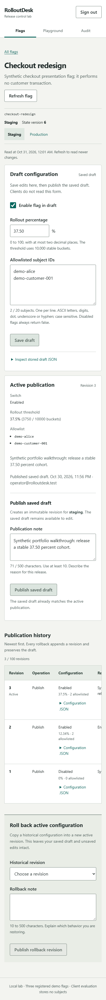

# RolloutDesk

RolloutDesk is a local feature-release lab built with Rust, React and PostgreSQL. An operator edits a draft, compares its decision with the published configuration, and releases a percentage of a synthetic audience. Publication history records each change, including rollbacks.

The project demonstrates version conflicts, atomic database changes, stable cohort selection and a separate client API. It uses three registered demo flags in two environments. It does not collect exposure events or control a real checkout.



## Run locally

You need Docker Desktop with Linux containers, Node.js 22 with npm, and PowerShell. Node runs the local configuration helper and frontend checks; the application itself runs in containers. Run from the repository root:

```powershell
.\scripts\Start.ps1
```

Open **http://127.0.0.1:8098**. Use the generated local credentials in `.local/LOCAL-CREDENTIALS.txt`. Passwords and client tokens are generated into the ignored `.env`; they are not committed to this repository.

Use that exact address. The application checks the browser's origin, so replacing `127.0.0.1` with `localhost` changes the origin.

The first start builds the backend and frontend. For subsequent starts with unchanged source:

```powershell
.\scripts\Start.ps1 -NoBuild
```

Stop the containers while keeping the application database:

```powershell
.\scripts\Stop.ps1
```

The Rust build runs inside Docker. A Windows Rust toolchain or Visual Studio C++ build tools are not needed for this workflow. See [operations](docs/OPERATIONS.md) for ports, credentials, testing and recovery.

The start/test scripts keep their subprocess temporary files in `.local/tmp` and restore the previous process settings afterward. Docker images, build caches and database volumes use Docker Desktop's separately configured disk image location. See [disk space](docs/OPERATIONS.md#build-output-and-disk-space) when keeping development files on D:.

## Try the release workflow

1. Sign in and open `checkout-redesign` in **staging**. The initial draft is disabled, and there is no active publication.
2. Enable the draft, enter `25.00` percent, and put `demo-alice` on the allowlist. Save the draft.
3. In Playground, compare draft and published decisions for `demo-alice`. The draft can return `ALLOWLIST` while the published side still returns `UNPUBLISHED`.
4. Return to the flag and publish the stored draft with a note explaining the change. Clients now evaluate that immutable revision.
5. Save and publish a second configuration. Roll back to the first revision with a note. Rollback creates a new revision containing the older configuration; it keeps the current draft.
6. Open the same environment in two tabs. Change it in one tab, then submit the older version from the other. The server rejects the stale write. Refresh and inspect the new state before retrying.

The Playground is read-only. It calls the backend's evaluator and shows its reason and bucket. It neither stores the subject nor creates an exposure or customer record.

## What the application keeps separate

| Concept | Meaning |
| --- | --- |
| Draft | Editable configuration saved for one flag and environment. Clients do not read it. |
| Publication | Immutable configuration snapshot with a revision, actor, note and timestamp. |
| Active revision | The publication currently read by the client API. |
| State version | Concurrency token for edits, publication and rollback. It is not a publication revision. |
| Bucket | Deterministic integer from 0 to 9,999 for a flag, environment and exact subject ID. |

The registered flags are `checkout-redesign`, `bulk-export` and `priority-support`. Each has independent `staging` and `production` state. The registry is deliberately fixed; there is no create/delete flag API.

## Implementation

| Layer | Choice |
| --- | --- |
| API | Rust 1.99.1, axum 0.8.9, Tokio, tokio-postgres and deadpool-postgres |
| Interface | React 19.3.1, TypeScript 5.9.3, Vite 6.4.5 |
| Persistence | PostgreSQL 17, explicit SQL and transactions |
| Runtime | Docker Compose; Nginx serves static assets and proxies the API |
| Operator access | Password login, opaque cookie session and CSRF token |
| Client access | Separate environment-scoped bearer tokens; published evaluation only |

Publication locks a flag/environment row, checks `expectedVersion`, appends a revision and audit entry, and changes the active pointer in one transaction. Rollback follows the same boundary and references its source revision. Read paths keep related state and history in one consistent database snapshot.

The evaluator hashes the flag key, environment and subject using a documented length-prefixed SHA-256 input. Revision and percentage are excluded from the hash. Increasing the percentage therefore retains the existing cohort. A percentage is a threshold over buckets, not a promise of an exact split in a small audience.

## Explore the REST API

The Rust service exposes 12 method/route pairs. Import [OpenAPI 3.0.3](docs/openapi.json) into an API client, or use the [Postman collection](docs/postman/RolloutDesk.postman_collection.json) with its [blank-secret environment](docs/postman/RolloutDesk.local.postman_environment.example.json). The [Indonesian walkthrough](docs/REST-CLIENT-GUIDE.md) explains each request, cookie/CSRF authentication, scoped bearer tokens and version conflicts.

With the latest web image running, the same files are available at `/openapi.json`, `/postman.collection.json` and `/postman.environment.example.json` on the local base URL. They are static JSON downloads. The Postman walkthrough saves two drafts, publishes both, rolls back while keeping the second draft, checks token scope and logs out. A complete run adds three publications to synthetic staging data.

## Screens

| Operator login | Draft, active revision and history |
| --- | --- |
|  |  |

<details>
<summary>Mobile view</summary>



</details>

## Tests and documentation

```powershell
.\scripts\Test.ps1
# With the application running, include browser workflows:
.\scripts\Test.ps1 -WithBrowser
```

The test database is separate from the application database. The [verification record](docs/VERIFICATION.md) lists the checks actually run and their results; the [UI review](docs/UX-REVIEW.md) records the final interface review.

Local browser checks use the installed Microsoft Edge; CI uses Chromium. Browser workflows change only the synthetic lab data, and repeated runs add publication history. See [operations](docs/OPERATIONS.md#verification) before running them against a lab you want to preserve.

- [Start from zero and read the code, in Indonesian](docs/CODE-GUIDE.md)
- [Interview explanation and demo, in Indonesian](docs/INTERVIEW.md)
- [Architecture and transaction boundaries](docs/ARCHITECTURE.md)
- [HTTP API, request examples and decision reasons](docs/API.md)
- [REST API and Postman tutorial, in Indonesian](docs/REST-CLIENT-GUIDE.md)
- [Operations, tests and troubleshooting](docs/OPERATIONS.md)

## Boundaries

This repository is a single-operator local learning project. It has no multi-tenant isolation, roles, hosted SDK, streaming updates, automated percentage ramp, exposure analytics or statistical experiment analysis. The client endpoint is read-only and does not log subjects or evaluation counts. Feature flags are not authorization checks.

The Docker setup exposes the web service and database on loopback. A public deployment would need its own TLS, secret rotation, backup/restore practice, identity policy and operational review. The supplied local settings are not a production-readiness claim.
