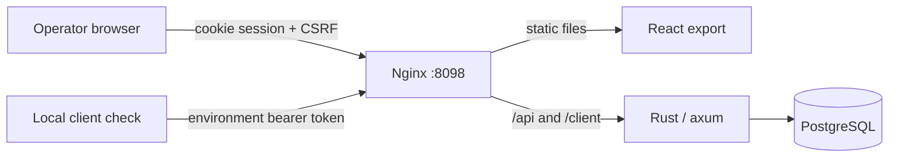

# Architecture

RolloutDesk separates configuration work from client evaluation. The operator saves drafts and creates immutable publications. A client token can evaluate only the active publication for its environment.



The browser receives no client token. `Client-Check.ps1` reads a token from private local configuration and calls the client route. Runtime configuration supplies only the token digests to the API. The API hashes a presented token and compares its digest for the requested environment.

## Stored state

The fixed registry contains three flags. Each flag has separate staging and production state. A state row holds its draft, optimistic concurrency version and active publication reference. Publication records hold complete immutable configurations. Audit entries describe accepted changes.

```text
flag key + environment
  draft configuration
  state version
  active publication -> immutable revision
                          config
                          kind + source revision
                          actor + note + timestamp
```

A state version identifies the row a user has read. A publication revision identifies a saved release snapshot. Saving a changed draft increments the state version without creating a publication. Publishing or rolling back increments the version and creates a publication. Identical draft saves may return the existing state without an audit entry.

There are at most 100 publications for each flag/environment pair. The server checks this limit while holding the state lock, so concurrent requests cannot both consume the final slot.

## Publication transaction

The server performs these steps within one PostgreSQL transaction:

1. Lock the requested flag/environment state.
2. Compare the submitted `expectedVersion` with the stored version.
3. Validate the operation, including publication capacity and whether the configuration differs from the active one.
4. Append an immutable publication containing the stored draft.
5. Update the active pointer and state version.
6. Append the audit entry and commit.

An error before commit leaves no partial revision, pointer change or audit entry. A concurrency conflict returns HTTP 409. Publication uses the stored draft, so unsaved browser edits cannot accidentally enter a release.

## Rollback transaction

Rollback accepts a revision from the same flag and environment. It copies that revision's configuration into a new publication with `kind: ROLLBACK` and `sourceRevision` pointing to the selected revision. It then updates the active pointer and audit in the same transaction.

The earlier publication remains unchanged, and the current draft remains unchanged. If revision 1 had a 25% configuration and revision 2 had 75%, rolling back to revision 1 creates revision 3 containing 25%. It does not make revision 1 mutable or renumber the history.

Selecting a revision whose configuration already equals the active configuration is a no-op and is rejected. A version conflict or lost response requires an explicit refresh before another mutation.

## Read consistency

A detail response contains the environment state, its active publication and history. These values must describe one database snapshot. A sequence of unrelated `READ COMMITTED` reads could otherwise observe an active pointer from one moment and history from another. Related multi-query reads use repeatable-read transactions; single-query joins also provide a statement snapshot.

The same rule applies to registry and audit pagination: totals and rows must agree within their read snapshot. Audit ordering includes an ID tie-breaker for identical timestamps.

## Deterministic evaluation

Configuration is `{enabled, rolloutBasisPoints, allowlist}`. A basis point is 0.01 percentage point, so `2500` means 25.00% and `10000` means 100.00%.

The bucket input contains:

```text
UTF-8("rolloutdesk:v1")
u32be(len(flagKey))     || UTF-8(flagKey)
u32be(len(environment)) || UTF-8(environment)
u32be(len(subjectId))   || UTF-8(subjectId)
```

The evaluator takes the first four SHA-256 digest bytes as an unsigned big-endian integer, then calculates `% 10000`. Length prefixes remove concatenation ambiguity. The environment separates staging and production cohorts. Exact subject spelling is case-sensitive.

Revision, enabled state, threshold and allowlist are excluded from the hash. A subject's bucket stays fixed while those configuration fields change. Raising the threshold from 2500 to 5000 retains all subjects that previously satisfied `bucket < 2500`, assuming the flag remains enabled.

Decision precedence is disabled, allowlist, percentage threshold, then outside rollout. A disabled configuration returns false even for an allowlisted subject. Unknown flags and unpublished flags also return false with distinct reason codes. A known unpublished flag still has a bucket but has no revision.

Modulo bucketing has negligible bias for this lab. A finite sample need not contain exactly the configured percentage. A true decision only controls this synthetic feature; it grants no permission to access protected business data.

## Authentication boundaries

Operator routes use a password-derived bcrypt hash and an opaque session. The server stores only the session token's SHA-256 digest. The cookie is HttpOnly, SameSite=Lax and valid for 12 hours. Local HTTP uses `Secure=false`; production hosting would require a separate TLS and cookie configuration review.

Login and authenticated mutations validate the exact origin. Mutations and preview also validate a session CSRF token. Password verification runs outside the asynchronous request reactor with bounded concurrency so CPU work cannot occupy every async executor thread. A persisted remote-address throttle permits at most 10 sign-in attempts per five-minute window; successful attempts also consume that budget. Its table holds at most 256 address digests. Because Nginx is the immediate peer, local proxy users share that address bucket; this is documented rather than presented as per-person rate limiting.

The bearer endpoint has a separate boundary: a staging token cannot evaluate production, cookie authentication is not required, and the response contains only a decision. It does not expose drafts or write an exposure record.

## Browser reconciliation

The UI has no background polling. Refresh is explicit and preserves dirty configuration and notes in tab memory. A stale or uncertain mutation locks further writes until refresh. It does not adopt a new version and silently resubmit.

This matters when the server commits a publication but its response is lost. The browser cannot infer failure from a network error. Refresh reveals the active revision; version checks and no-op guards prevent a second click from blindly creating another release.

## Runtime boundary

Compose runs PostgreSQL, one Rust API process and Nginx. The frontend is a static Vite build. There is no server-rendered frontend, event worker, cache, message broker or outbound integration. Only loopback web and database ports are published to the host. The application database volume survives the normal stop command; tests use a separate temporary database.
